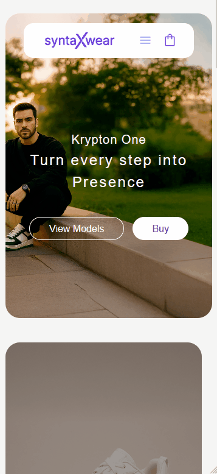

# SyntaxWear App

*Leia em português: [🇧🇷 Português](README.pt-br.md)*

## 📝 Project Description

SyntaxWear is a responsive footwear storefront built with React and TypeScript. It brings together a product catalog, category browsing, product details, a shopping cart, and informational pages in one e-commerce-style experience.

The project is a frontend study/demo: product data is local, and account and checkout flows are not connected to a real commerce or authentication service.

Access the website here: [Syntax Wear App](https://syntax-wear-app-black.vercel.app/)

## 🎨 Project Overview

<div align="center">
   <div align="center">
    
   <br><br>
    <br>
   </div>
</div>

## 🔎 Features

- Responsive storefront with home, about, and stores pages
- Product catalog with category and product detail pages
- Add products to the cart, change quantities, and remove items
- Cart contents persisted in the browser using `localStorage`
- ZIP code lookup using the ViaCEP API and estimated shipping cost by region
- Sign-up form with client-side validation
- Reusable React components and typed product/category data

> The sign-in, sign-up submission, and checkout are UI demonstrations only; no user account or order is created.

## 🛠️ Technologies Used

- React 19 and TypeScript
- Vite
- TanStack Router
- Tailwind CSS 4
- React Hook Form and Zod
- React Icons
- `localStorage` for cart persistence
- ViaCEP API for ZIP code lookup

## 💡 Project Decisions

1. **Component-based UI** — shared elements such as the header, footer, product cards, forms, and cart drawer are organized as reusable components.
2. **Client-side routing** — TanStack Router provides routes for the storefront, product categories, product details, and account screens.
3. **Local catalog data** — products and categories are defined in `src/mocks/`, keeping the demo independent of a product backend.
4. **Cart state** — a React context centralizes cart operations; the cart is restored from and saved to `localStorage`.
5. **Form validation** — React Hook Form and Zod are used for form handling and validation.

## 📁 Project Structure

```text
src/
├── assets/          # Images and fonts
├── components/      # Shared UI components
├── contexts/        # Cart context and provider
├── interfaces/      # Product, category, and address types
├── mocks/           # Local product and category data
├── pages/
│   ├── _app/        # Storefront pages
│   └── _auth/       # Sign-in and sign-up pages
├── styles/          # Global styles
├── utils/           # Formatting and validation helpers
├── App.tsx
├── main.tsx
├── router.tsx
└── routeTree.gen.ts # Generated route tree
```

## 🚀 Getting Started

### Prerequisites

- Node.js compatible with Vite 8
- npm
- Git

### Installation

1. Clone the repository:

   ```bash
   git clone https://github.com/cezarviana/syntax-wear-app.git
   cd syntax-wear-app
   ```

2. Install dependencies:

   ```bash
   npm install
   ```

3. Start the development server:

   ```bash
   npm run dev
   ```

4. Open the URL printed in the terminal. The configured local address is usually `http://localhost:3000`.

### Available Scripts

- `npm run dev` — start the Vite development server on port 3000
- `npm run build` — type-check and create the production build
- `npm run preview` — preview the production build locally
- `npm run lint` — run ESLint
- `npm run check` — check formatting with Prettier
- `npm run generate-routes` — generate the TanStack Router route tree

## 📌 Notes

SyntaxWear is a portfolio/demo storefront and does not process payments or persist customer accounts. ZIP code lookup requires an internet connection to reach ViaCEP.
